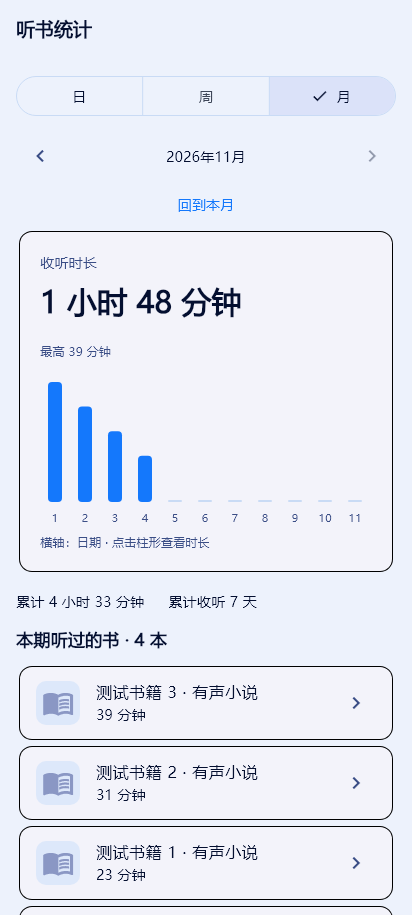

# 听书统计与书籍介绍

## 使用

进入“我的 → 听书时长”，可以查看今日与累计时长。点击卡片进入统计页，切换日、周、月，使用左右箭头查看历史周期。柱形图可横向滚动，点击柱形查看对应时长；点击本期书籍可进入详情页。

下图使用模拟数据展示统计页，不包含真实收听记录：



书籍详情页在目录前展示“书籍介绍”。长文可展开、收起，展开后可选择复制文本。内容来自 B 站原作品简介，原作品未提供内容时显示“暂无介绍”；UP 主不等同于原著作者。

## 统计口径

- 按实际经过的收听时间累计，2 倍速听 10 分钟计 10 分钟。
- 后台、锁屏和离线播放均通过同一播放器记录。暂停、缓冲、切换加载和停止时结束当前计时区间。
- 快进快退不按跳过的音频长度计时，重复收听按实际投入时间累计。
- 日统计按本机本地日期和小时分桶，周统计从周一开始，月统计按自然月汇总；跨午夜的连续收听分入两天。
- 从启用功能后开始记录，不从旧书架进度反推历史数据。
- 数据保存在本机，卸载会清除，不提供跨设备同步。

## 实现与误差边界

`ListeningTracker` 使用单调时钟累计时长，音频位置只用于确认播放推进和排除跳转。播放器的播放、缓冲、跳转、切书切章、停止和生命周期事件接入统一计时组件。

数据按日期、小时和作品 bvid 聚合，使用独立的 `abts_listening_history_v1` 存储键，不改变书架进度。每 5 秒尝试落盘，暂停、切书、停止和退后台也会保存，写入串行执行。页面通知最多按约一秒的间隔刷新，避免位置流造成整页频繁重建。

异常强杀可能丢失最后一次成功保存后的短暂记录，正常持久化条件下目标约为 5 秒以内；存储持续失败时不保证此上限。损坏的 JSON 会先备份为 `.corrupt` 键；有效 JSON 中的无效行会跳过。保存错误在统计页提示，后续周期自动重试。

如果系统长时间挂起 Dart 回调，超过 5 秒的采样间隔会被保守排除，可能少计该段时间；这避免将系统挂起、断流或异常停滞全部记作听书。正常播放状态仍需在真实设备上验证。

## 自动验证

在已配置的 Flutter 环境中运行：

```powershell
flutter pub get
dart analyze
flutter test --reporter expanded
flutter build apk --release --target-platform android-arm64
```

在没有桌面软链接权限的 Windows 环境中，仅构建 Android 时可先设置 `$env:FLUTTER_WINDOWS='false'` 再运行 `flutter pub get`。必须确认该命令成功完成；不能在它失败后直接用 Gradle 绕过插件注册生成。项目已增加缺失注册文件时的构建检查。

测试覆盖：2 倍速实际时长、前后跳转、暂停状态、停滞、章节/书籍边界、跨小时/午夜/月/闰日、周一边界、损坏记录、加载期间新记录、连续写入后重启恢复、空页面、周期导航、未来周期限制、360/412 像素手机与宽屏、深浅主题、长简介展开/复制/收起与空简介。

页面测试还会在 `build/previews/listening-stats-phone.png` 输出模拟数据的渲染预览；该图片仅用于布局检查，非用户真实听书数据。

## 荣耀 Magic8 Pro / Android 17 验收

1. 正常播放约两分钟并进入统计页，检查今日时长增加。
2. 切到 2 倍速继续收听一分钟，检查增加约一分钟；快进数分钟不应直接增加相同的统计时长。
3. 暂停一分钟，时长不应继续增长；恢复后应继续累计。
4. 锁屏和切后台播放，检查系统媒体控制和统计均正常。
5. 播放缓存音频验证离线记录；断网触发缓冲时检查是否停止计时。
6. 跨午夜连续收听，检查记录分入两天；正常退出重进后检查数据恢复。
7. 在浅色、深色和横屏下打开长简介，检查换行、展开收起及复制。

本次自动验证不等同于上述真机验收。

## 本次实施验证结果（2026-11-04）

- `dart analyze`：No issues found。
- `flutter test --reporter expanded`：7 项测试全部通过。
- `git diff --check`：通过。
- 手机统计页渲染预览已目视检查；测试中的时长和书籍均为模拟数据。
- 构建环境：Flutter 3.47.9、Dart 3.13.7、JDK 21、NDK 28.2.13676358、CMake 3.22.1。保留原项目依赖版本；增加友盟插件重复示例类的构建排除修复。
- Android ARM64 release APK 已成功生成，签名与 ZIP 对齐检查通过。此前的下载连接错误、缺失 SDK/CMake 和插件重复类冲突已处理。
- 真机完成三次冷启动及书架、“我的”、统计页响应验证，未观察到新增 ANR。长时间后台、锁屏和离线收听尚未完整验收。
- Android 构建准备、插件注册检查与友盟重复示例类修复见 [Android 构建说明](android-build.md)。
